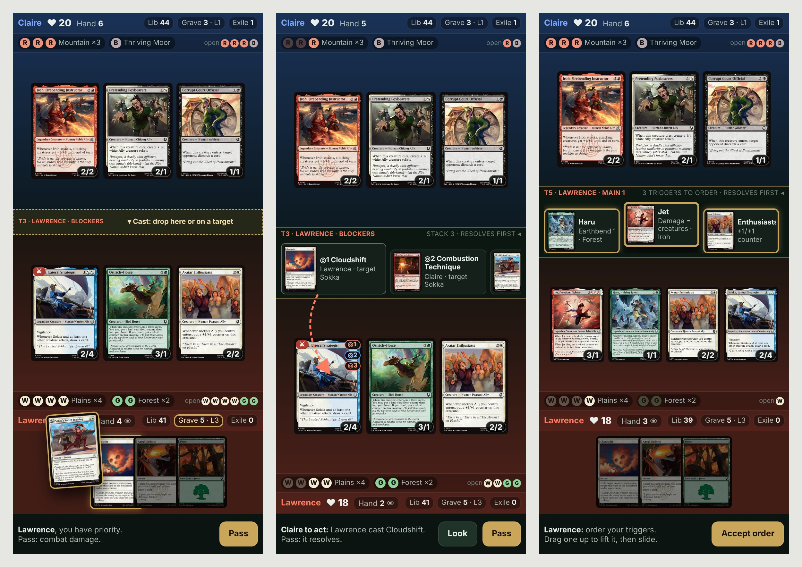

# Travel Tabletop v3

<p align="center">
  
</p>

A rules-enforcing Magic: The Gathering game that runs as an offline web app on phones and tablets.
Two players share one device; the app runs every turn, step and priority pass, pays mana, resolves
combat and tallies every number, and allows only legal moves. It plays the Avatar card pool: each
deck is three of the 76 twenty-card Beginner Box and Jumpstart packets.

**Status:** playable, with the 10 Beginner Box decks; the Jumpstart packets come next. The board
above is the design mockup. [v2](https://github.com/pikalaw/travel-tabletop) is the rules-free playmat.

**Site:** https://pikalaw.github.io/travel-tabletop-v3/

## Docs

- [Product requirements](docs/prd.md)
- [Technical design](docs/technical-design.md), with the build order (M0–M5)
- [Adding cards and mechanics](docs/technical-design.md#adding-cards-and-mechanics): a card is one
  script file and its test; a new mechanic is one effect module
- [All docs and assets](docs/README.md)

## Run it

```sh
npm install
npm run dev          # development server with hot reload
npm run build        # type check, then build into dist/
npm run preview      # serve dist/ at http://localhost:4173/travel-tabletop-v3/, as GitHub Pages will
```

## Card data

The card pool is committed: `src/cards/cards.json` (packets, printed values, tokens, rulings) and
`public/cards/` (each card's large image). Both are built from the v2 deck export, and only need
rebuilding when the export changes:

```sh
node scripts/build-cards.ts path/to/unzipped-v2-export
```

## Check it

```sh
npm run typecheck && npm run lint && npm test && npm run e2e
```

Every push runs the same checks on GitHub Actions; a push to `main` that passes them is published
to GitHub Pages.

Strict TypeScript, built with Vite; Preact for the UI; Vitest with fast-check, and Playwright.
