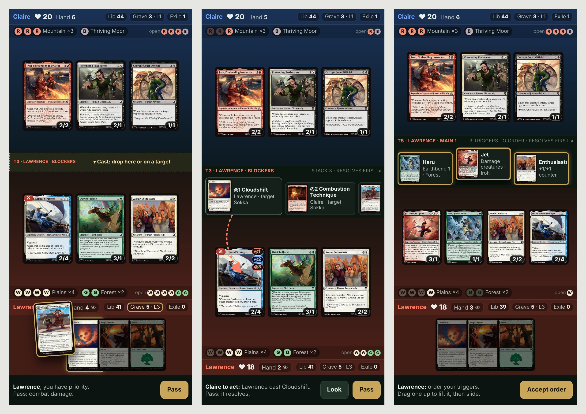

# Travel Tabletop v3 — Product requirements

Nov 23, 2026 · @Lawrence Tsang

## Overview

v3 turns the v2 playmat into a rules-enforcing game: two people share one device, the app runs every turn, step and priority pass, and only legal moves happen. It plays the Avatar card pool only, in two-player constructed games with decks of three 20-card packets, and it tallies every number a player would otherwise track by hand.

What changes from v2:

|           | v2                                               | v3                                                                                                 |
|-----------|--------------------------------------------------|----------------------------------------------------------------------------------------------------|
| Rules     | None: a playmat, players move anything anywhere  | Enforced: the app knows turn structure, costs, timing, combat and every card in the pool           |
| Devices   | One device, or two over local Wi-Fi              | One device only; no networking, pairing or TURN                                                    |
| Card pool | Any card imported from Scryfall                  | The Avatar cards in the user's Scryfall export; nothing else is playable                           |
| Numbers   | Counters and "This turn" changes entered by hand | Power, toughness, counters, life and mana computed by the engine                                   |
| A drag    | Moves the card                                   | States an intent (cast, play a land, attack); the engine checks it, asks for choices, then does it |
| Undo      | Reverts the last action                          | Reverts the last decision, back to any earlier one                                                 |

v3 lives in its own GitHub repository, so v2 stays as it is. It keeps v2's stack (an offline PWA in Preact and TypeScript) and its look: the role colours, the full-screen card view, the log and the footer. The board layout is new (see Board layout).

## Goals and non-goals

**Goals**

- Every rule that the Avatar cards touch is enforced: an illegal action is never offered, or is refused with the reason.
- Every card in the pool works as printed. A card the engine does not support yet cannot go in a deck.
- Nothing is tallied by hand: the engine computes power and toughness, counters, life and mana.
- Two people can play a whole game on one phone or tablet without seeing each other's hidden cards.
- Any decision can be undone, so a mis-tap or a misunderstood rule never ruins a game.
- It still works offline, as v2 does.

**Non-goals**

- Cards outside the Avatar pool, and rules only other sets need (for example sagas, planeswalkers or day/night, unless an Avatar card uses them).
- Two devices, an online opponent or spectators.
- A computer opponent.
- Moving cards freely as in v2. There is no manual mode; undo is the escape hatch.
- Commander, in any form, and games of three or more players.
- Deck building beyond importing a list and checking it is legal.

## Players and the shared device

At every moment the engine knows which player must act (the player with priority, or the one a choice belongs to), and the screen belongs to that player. When it changes hands, the app blinds first and hands over, as v2's Blind and Unblind do; hidden cards are never on screen for the wrong person.

**Hand-offs.** When the acting player changes, the board shows the public view and a hand-off bar: "Claire to act: Lawrence cast Fists of Flame". Claire then picks one of two buttons:

- **Pass** answers without showing her hand. Most hand-offs end here, in one tap.
- **Look** shows her hand and the full choice: respond, block, choose targets, and so on.

**Why this matters.** The rules give the other player priority in every step: upkeep, draw, both main phases, each combat step, the end step. They also get it twice more for each spell. Taken literally, that's ten or more hand-offs a turn. Four rules bring it down without revealing anything.

1. **A pass costs one tap.** Passing needs no hidden information, so the phone can stay flat on the table: the other player taps Pass on the hand-off bar, and no hand is shown. The phone really changes hands only when someone taps Look to act, so the cost falls on the player who's acting, as in paper.
2. **Windows open only where instants matter.** The pool's 55 instants and 5 flash cards are nearly all combat tricks, removal and three counterspells; almost nothing wants upkeep or the draw step. The engine passes for both players everywhere else.
3. **The windows are fixed, public and the same for both players.** No per-player settings: if one player's stops were private, a window opening would hint at what they hold. With fixed stops, a window says nothing about anyone's hand. Whether to stop never depends on hidden cards; skipping a window because a hand has no instants would tell the opponent exactly that.
4. **Your own priority after casting is passed for you.** After you cast, the rules give you priority again; the app passes it, unless you tick "Hold priority" while casting, to respond to your own spell.

The windows (a step with neither player's window passes by itself):

| Window                               | Who gets the one-tap choice                        |
|--------------------------------------|----------------------------------------------------|
| Something goes on the stack          | The player who didn't put it there                 |
| Attackers declared                   | The defending player                               |
| Blockers declared                    | The active player first, then the defending player |
| The active player's end step         | The other player                                   |
| Each main phase, with an empty stack | The active player (to cast at sorcery speed)       |

A typical turn then has the blocking decision and about three one-tap windows, plus one per spell. The phone moves only when someone responds.

**Passing ahead, out loud.** At any window a player may choose "Pass this combat" or "Pass until end of turn". Since that is a statement about one's own hand, the app shows it to both players ("Claire passes until end of turn"), as saying "no responses" would at a table. It's chosen, not inferred.

**Choices that belong to the other player** always hand off, whether or not they need hidden cards: blocking, discarding, choosing a mode for their own trigger, ordering their triggers, and the mulligan. Private looks (search, scry, "look at the top N") happen only on the owner's screen; the other player sees that a look happened and how many cards.

**Blinded between turns.** Passing the turn blinds the device and hands it to the next player, as in v2.

## Format

One format: two-player games under the standard rules of play, with each deck made of exactly three different packets out of the 76 twenty-card packets (60 cards). Commander is out of scope.

| Rule          | v3                                                                                                                                                                                                                                                       |
|---------------|----------------------------------------------------------------------------------------------------------------------------------------------------------------------------------------------------------------------------------------------------------|
| Deck          | Three different packets shuffled together: 60 cards. Both players may pick the same packets, and Beginner Box decks mix with Jumpstart packets                                                                                                           |
| Copies        | Within the standard limits by construction: no packet holds two copies of any card, so three different packets hold at most three copies of a card other than basic lands, and the deck meets the 60-card minimum. The legend rule still applies in play |
| Starting life | 20                                                                                                                                                                                                                                                       |
| First player  | Chosen by a seeded coin flip, whose winner chooses to play or draw; in a rematch, the loser of the last game chooses. Whoever plays first skips the draw on turn 1                                                                                       |
| Mulligan      | London mulligan: draw 7, put one card on the bottom per mulligan taken                                                                                                                                                                                   |
| Lands         | Each packet brings 6 to 8 basic lands, so lands stay about a third of any deck, plus any Thriving lands                                                                                                                                                  |

**Choosing packets.** The game setup lists the packets with their colours and themes ("Avatar JS: Firebending (1)"). Packets in three or more colours are legal but harder to cast, so the setup shows the deck's colours and size as packets are picked. A pick can be saved and named for next time.

## Rules the app enforces

The engine follows the Magic Comprehensive Rules (at least the 14 November 2025 edition, which added the Avatar mechanics), limited to what the card pool can reach. Every rule below is applied without asking; the players only make the choices the rules give them.

**Turn structure.** Untap, upkeep, draw; first main phase; combat (beginning, declare attackers, declare blockers, combat damage, with a first-strike damage step when needed, end of combat); second main phase; end step; cleanup (discard to seven, damage wears off, "until end of turn" effects end). Steps where nothing can happen and no one has a stop pass by themselves.

**Priority and the stack.** Players get priority as the rules say: the active player first, then the other after each pass. Spells and abilities go on the shared stack and resolve top first once both players pass in a row. Mana abilities don't use the stack.

**Casting and costs.** The engine allows only what's legal now:

- **Timing:** sorcery speed versus instant speed, and one land per turn.
- **Costs:** the full cost, with additional and alternative costs, cost increases and reductions (Gran-Gran's discount, affinity for Allies) and X.
- **Choices:** targets, modes, and how damage or counters are divided.

Mana is paid automatically: players never tap lands by hand. The app taps lands first, and keeps the most useful colours open for the rest of the turn. It asks only when paying would tap a creature (a mana creature, an earthbent land, or a creature helping a waterbend cost), since that creature then can't attack or block, or when two choices leave different colours open and neither is clearly better. The confirm step before paying shows which sources will be tapped, and you can swap any of them.

**Draws happen by themselves.** The draw for the turn and every "draw a card" effect move the card straight to the hand. The app asks only for the real choices: a "may draw", which cards to keep from "look at the top three", what to discard after "draw, then discard". A choice that belongs to the other player hands off.

**Abilities.** Activated abilities with their costs and timing. Triggered abilities go on the stack the next time a player would get priority. When several trigger at once: the active player's first, then the other's, and each player orders their own. Targets and modes are chosen as the trigger goes on the stack. Static abilities apply all the time, in the rules' layer order.

**Combat.** Legal attackers (not summoning-sick unless they have haste; vigilance doesn't tap) and legal blocks (flying, reach, menace and other restrictions). Damage follows first strike, double strike, trample, deathtouch and lifelink. The active player assigns an attacker's damage among its blockers.

**Combat resolves itself.** Players declare attackers, then blockers; the engine does everything else:

- the first-strike damage step;
- combat damage, with deathtouch, trample and lifelink applied;
- creatures dying, triggers, life totals.

The one choice left is an attacker blocked by two or more creatures. Since the 2024 rules, its controller divides its damage among the blockers however they like. With trample, every blocker must get lethal damage before any goes to the player. Lethal means toughness minus damage already marked, or 1 from a deathtouch source.

- **Asked only when it matters.** With no trample and enough power to give every blocker lethal damage, every split gives the same result, so the engine does it without asking. Otherwise, the attacking player gets a prompt.
- **The prompt is pre-filled.** Lethal damage goes to the blockers with the least lethal needed first, so the most blockers die, and the rest goes to the last blocker, or to the player with trample. A stepper sits under each blocker on the board, plus one for the player when there's trample. The total stays equal to the attacker's power; one tap on Confirm accepts it.
- **Once per damage step.** With first strike in combat, the split is asked in each damage step for the attackers dealing damage then.
- **Blocking several attackers.** No card in the pool lets one creature do it, so the defending player never splits damage.

**State-based actions,** checked whenever a player would get priority:

- A player loses at 0 life, or on drawing from an empty library.
- A creature with 0 toughness, or with lethal damage, dies.
- The legend rule applies.
- +1/+1 and −1/−1 counters on the same permanent cancel in pairs.
- An Aura with an illegal object is put into the graveyard.
- Tokens that left the battlefield cease to exist.

**Replacement and prevention effects** change an event as it happens. If two apply, the affected player or object's controller chooses the order.

**Game end.** Win, loss and draw are declared by the engine, with the reason.

## Card pool and set mechanics

The pool is 343 different cards in 76 twenty-card packets, plus 11 tokens, from the user's v2 deck export of 9 November 2026. It has no commanders and no decks larger than 20 cards: every list is a Beginner Box deck or a Jumpstart packet.

|                     | Count                                                                                                                                                                                                                     |
|---------------------|---------------------------------------------------------------------------------------------------------------------------------------------------------------------------------------------------------------------------|
| Packets             | 10 Beginner Box ("Avatar BB"), 66 Jumpstart ("Avatar JS"), each 20 cards                                                                                                                                                  |
| Different cards     | 343: 5 basic lands, 338 others                                                                                                                                                                                            |
| By set              | Avatar: The Last Airbender 191, Avatar Eternal 140, 12 reprints from other sets (the five Thriving lands, Brainstorm, Frantic Search, Lightning Strike, Valorous Stance, Run Amok, Duelist's Heritage, Cathartic Reunion) |
| By type (non-basic) | 190 creatures (86 legendary cards in all), 55 instants, 36 sorceries, 34 enchantments (4 sagas, 8 Auras), 18 artifacts (9 Equipment, 4 Vehicles), 8 lands                                                                 |
| Tokens              | Ally, Soldier, Spirit, Clue, Food, Ballistic Boulder, Copy, Human Soldier and a few more                                                                                                                                  |
| Rulings             | 337 cards have a rulings entry, 170 with text                                                                                                                                                                             |
| Images              | 1,062 files, 80 MB (small and large)                                                                                                                                                                                      |

**The set's mechanics,** by how many cards use each:

| Mechanic                | Cards                               | What the engine needs                                                                                                                                 |
|-------------------------|-------------------------------------|-------------------------------------------------------------------------------------------------------------------------------------------------------|
| Allies (creature type)  | 79                                  | Type checks and counts ("for each Ally you control", affinity for Allies)                                                                             |
| Lessons (spell subtype) | 42, and 23 cards that refer to them | Counting Lesson cards in a graveyard                                                                                                                  |
| Earthbend N             | 21                                  | A land becomes a 0/0 creature with haste and N +1/+1 counters; when it dies or is exiled it returns tapped (type change, counters, a delayed trigger) |
| Firebending N           | 20                                  | An attack trigger that adds {R} which lasts until end of combat instead of emptying between steps                                                     |
| Waterbend {N}           | 17                                  | A cost you may help pay by tapping your artifacts and creatures, {1} each (like convoke)                                                              |
| Airbend                 | 9                                   | Exile a permanent; while exiled, its owner may cast it for {2} instead of its mana cost                                                               |
| Food, Clue              | 28                                  | Predefined tokens with sacrifice abilities                                                                                                            |
| Exhaust                 | 6                                   | An activated ability usable once                                                                                                                      |
| Stun counters           | several                             | Replacement: a stunned permanent stays tapped instead of untapping, losing one stun counter                                                           |

**Other rules the pool needs:**

- **Common keywords:** flying, vigilance, reach, menace, defender, first and double strike, trample, deathtouch, lifelink, haste, flash, hexproof, ward, prowess.
- **Keyword abilities:** cycling (including landcycling and typecycling), kicker, flashback, storm, affinity.
- **Library and graveyard actions:** scry, surveil, mill.
- **Permanents:** sagas, Equipment, Auras and Vehicles with crew.
- **Costs:** hybrid mana and X costs.
- **Choices:** modal spells, dividing counters.
- **Effects:** counterspells.
- **Counter kinds:** experience, quest and lore counters.
- **Memory:** "this turn" facts (29 cards).

**Rules the pool never touches, which the engine can leave out:** planeswalkers, battles, double-faced cards, control-changing effects, extra turns or combats, damage prevention, poison, Phyrexian mana, switching power and toughness. Each was checked by searching the whole pool for it. Two near misses the engine must still model: an owner who isn't the controller (Fire Nation Salvagers puts the opponent's card onto your battlefield; Fire Lord Ozai and Hama cast the opponent's cards), and layer dependencies (613.8), which Honest Work needs (below).

**Hard cards.** The M0 scan ([docs/card-scan.md](./card-scan.md)) read every ability line in the pool and lists 38 cards whose rules go beyond the effect vocabulary, sized as 2 large (a week or more), 9 medium (a few days) and 27 small (a day or less). The large and medium ones:

- **Koh, the Face Stealer** (L): has every activated and triggered ability of the last chosen card exiled with it.
- **Honest Work** (L): loses all abilities and becomes a 1/1 Citizen named Humble Merchant with a mana ability, which touches layers 3, 4, 6 and 7 at once. On a creature whose ability grants others theirs (Aang, Air Nomad; Smellerbee), the removal must apply first: a real 613.8 dependency.
- **Copies on the stack:** Firebender Ascension (copy a triggered ability), Jeong Jeong (copy the next Lesson), Storm of Memories (storm, and a free cast from the graveyard).
- **Bolt Bend:** changes the target of a spell or ability.
- **Casting from elsewhere:** Hakoda (look at and cast from the top of the library), Hama (cast the opponent's exiled card by waterbending), Fire Lord Ozai (play the opponent's exiled card; combat-long mana).
- **Princess Yue:** returns as a land named Moon, if she was a nonland creature.
- **Animal Attendant:** mana that remembers what it was spent on.

The small ones include the token copies (Joo Dee, Ran and Shaw), free casts (Descendants' Path, Yue, the Moon Spirit; Zuko, Exiled Prince), choices that belong to the other player (Combustion Man, Wan Shi Tong, Destined Confrontation), the private reveal of Dai Li Indoctrination, and Solid Ground's replacement.

## Auto-tallied numbers

No number is typed in v3: the engine computes each one, and a tap on any number shows where it came from.

| Number              | Shown on                                                                                                                | Comes from                                                                                                                                                                                                             |
|---------------------|-------------------------------------------------------------------------------------------------------------------------|------------------------------------------------------------------------------------------------------------------------------------------------------------------------------------------------------------------------|
| Power and toughness | A badge on each creature, green when above the printed value, red when below                                            | The printed value, then every effect in layer order: setting effects, +1/+1 and −1/−1 counters, "until end of turn" changes (the v2 "This turn" line, now automatic), static abilities such as anthems, then switching |
| Damage marked       | A small red mark beside the toughness                                                                                   | Damage dealt this turn; it wears off in cleanup                                                                                                                                                                        |
| Counters            | The card's badges, as in v2                                                                                             | Placed and removed only by card effects and the rules                                                                                                                                                                  |
| Life                | Each player's stats box                                                                                                 | Damage, life loss and life gain, with lifelink                                                                                                                                                                         |
| Poison              | The stats box, when above 0                                                                                             | Poison counters given by effects                                                                                                                                                                                       |
| Mana pool           | The lands strip's open pips, plus floating mana in gold                                                                 | Mana added and not yet spent; it empties between steps                                                                                                                                                                 |
| A card's cost       | The card in hand, when it differs from the printed cost                                                                 | The printed cost plus kicker and other additional costs, increases and reductions                                                                                                                                      |
| Conditions          | A small check on the card when a condition it states holds (for example "three or more Lesson cards in your graveyard") | Counted from the game state                                                                                                                                                                                            |

Example breakdown, shown on a tap: "Sokka 4/6 = 2/4 printed + 1/1 counter + 1/1 from Iroh until end of turn".

## Board layout

The battlefields get the full width of the screen. Nothing is dropped on a pile any more, so the graveyards, exiles and libraries shrink to icons. Lands, which nobody taps by hand, shrink to a thin strip. Both orientations are required. Portrait comes first and is specified here; landscape, for phones and tablets, follows in a later milestone and gets its own layout then. From the top of a phone held upright:

| Band                   | What it shows                                                                                                                                                                                                                                                                                                                                                           |
|------------------------|-------------------------------------------------------------------------------------------------------------------------------------------------------------------------------------------------------------------------------------------------------------------------------------------------------------------------------------------------------------------------|
| Opponent's stats bar   | Name in the turn colour, life, hand size (on your own bar, a tap hides or shows your hand); then icons: Library (count), Grave (count, and Lessons as "L1"), Exile (count)                                                                                                                                                                                              |
| Opponent's lands strip | One chip per land name ("Mountain ×3"), a pip per land, dimmed when tapped; at the right, the mana still open ("open R R B")                                                                                                                                                                                                                                            |
| Opponent's battlefield | Their creatures and other non-land permanents, full width, each with its power/toughness badge                                                                                                                                                                                                                                                                          |
| Centre band            | With an empty stack: "Turn 3 · Lawrence · Combat: blockers declared", in the active player's colour. With something on the stack: the turn shrinks to the left ("T3 · Lawrence · Blockers") and the band grows to a row of small cards, top item first ("Stack 1 · Fists of Flame · Lawrence · target Sokka"); it scrolls sideways, and a tap opens an item's full view |
| Your battlefield       | As the opponent's                                                                                                                                                                                                                                                                                                                                                       |
| Your lands strip       | As the opponent's                                                                                                                                                                                                                                                                                                                                                       |
| Your stats bar         | As the opponent's                                                                                                                                                                                                                                                                                                                                                       |
| Your hand              | Folded away while blinded or during a hand-off; castable cards glow gold, the rest are dimmed                                                                                                                                                                                                                                                                           |
| Footer                 | The priority and prompt bar: what passing does ("Pass: combat damage"), Pass, and during a hand-off the hand-off bar with Look and Pass                                                                                                                                                                                                                                 |

**The pile icons** open their sheet on a tap, as v2's pile viewers do. An icon glows when something inside is legal for you to use now (a flashback card in your graveyard, an airbended card in exile). When an effect targets a card in one of them, its sheet opens by itself with the legal choices outlined.

**Lands as creatures.** An earthbent land is a creature, so while it is one it sits on the battlefield row with a power/toughness badge, and leaves its strip; it returns to the strip when it's a land again.

**Which way the board faces.** The players sit side by side, and the bottom half always belongs to whoever is looking. The board faces the player whose turn it is, and flips at each turn change. When the other player taps Look to act, it flips to her for as long as she acts, then flips back. A one-tap Pass on the hand-off bar flips nothing, since the footer reads the same either way, so the board moves only when the phone really changes hands. Each flip is a short animation, so it never looks like the cards jumped.

**The Hand chip.** Tapping your own Hand count folds your hand away or brings it back, for when the other player glances over. The opponent's Hand chip shows the count only and does nothing on a tap, because only the app decides whose hand may be seen. During a hand-off, tapping the Hand chip of the player about to act does the same as the footer's Look.

**The stack row.** With an empty stack the centre band is one thin line (about 28 px). When something goes on the stack it grows, with an animation, to one row of small cards (about 85 px), taking the height from the two battlefields so nothing else moves. The row is a side scroller: the top item, which resolves next, sits at the left end, slightly larger, with its controller and targets, under a small "resolves first" label; older items trail to the right, smaller. "Stack 3" counts every item, so it is clear when some are off screen. A tap on any item opens its full view.

**Showing targets.** A stack item names its targets in words ("Lawrence · target Sokka"), and the board shows them too:

- **Target rings.** Everything a stack item targets carries a small numbered ring, ◎1, the number being that item's place on the stack (1 is the top), in the colour of the spell's controller. The ring sits on a permanent; on a player's stats bar when the target is the player; on a pile icon when the target is a card in that pile; or on another stack item, as for a counterspell like Sokka's Haiku. With several items on the stack, each ring says which spell it belongs to.
- **One arrow at a time.** An arrow runs from a stack item to its targets: the top item's by default, since that is what players respond to, or the item last tapped in the stack row. Arrows for every item would cross once there are three.
- **A lost target shows at once.** When a target leaves or stops being legal (a creature that blinks comes back as a new object, CR 400.7), its ring goes, and the stack item reads "target gone: does nothing". An item whose every target is gone will be removed without effect when it would resolve.

**Auras on the battlefield.** An Aura sits tucked behind the permanent it enchants, peeking out above that card's top edge, and the enchanted card's full view lists it. It stays with what it enchants even when the controllers differ, so Watery Grasp or Swampsnare Trap sits on the opponent's side, with an edge in its own controller's colour. The pool has 8 Auras.

**One gesture rule for every scroller.** In the hand row and the stack row alike, a sideways drag scrolls the row, and a drag up or down lifts a card out of it.

**The band as a drop zone.** While you drag a castable card, the centre band lights up as "Cast", so there is an obvious place to aim. It is not the only place: a drop on empty battlefield space casts as well, a drop on a legal target targets it, and the confirm step still catches a slip.

**Ordering simultaneous triggers.** When several of one player's abilities trigger at the same moment, that player chooses the order they go on the stack (CR 603.3b); the last one put on resolves first. For example, with Avatar Enthusiasts and Haru, Hidden Talent in play, a third Ally entering triggers both. When the order can't matter (identical copies, or triggers that don't touch what the others read or target), the app sets it and asks nothing; when in doubt, it asks:

1. The triggers appear at the left end of the stack row at once, in a pre-filled order, highlighted as pending.
2. Only the highlighted cards can be moved: lift one with a drag up or down, then slide it sideways to its place. A sideways drag elsewhere still scrolls.
3. The footer names who is deciding ("Claire: order your triggers") and offers **Accept order**. Nobody gets priority until it is tapped, so no one can respond halfway through.
4. When both players' abilities trigger together, the active player orders theirs first, and they go lower in the stack; then the other player orders theirs, on top (CR 603.3b). Only the deciding player's cards are highlighted. Triggers are public, so this needs no blind hand-off.

**What it gains over v2:** the Command cells and the side columns are gone, and the lands rows drop from about 83 px to 30 px each. On a phone held upright, the battlefields span the full 390 px width instead of about two thirds of it, and each is about 270 px tall with the hand showing.

Mockup (390×844, the real cards from the export). Left: Lawrence has priority after blocks and is dragging Sokka's Sword Training, so the thin band lights up as Cast. Middle: the hand-off to Claire with three items on the stack, Cloudshift on top, all three targeting Sokka (rings ◎1–◎3, the arrow for the top item), and Lawrence's hand folded away. Right: Jet, Freedom Fighter has just entered; Haru's, Jet's and the Enthusiasts' triggers wait to be ordered, with Jet's lifted. Here the order matters: if Haru's earthbend resolves first, the land is a creature by the time Jet counts.

The frames one at a time: [acting](images/mockup-acting.jpg), [hand-off](images/mockup-handoff.jpg), [ordering triggers](images/mockup-ordering.jpg). Their source is in [mockup/](mockup/).

## Playing

The board and gestures stay v2's; what changes is that every gesture asks the engine first. A drag is an intent, the engine answers with the choices it needs, and only then does anything move.

| Gesture                                                 | v3 meaning                                                                                                                                |
|---------------------------------------------------------|-------------------------------------------------------------------------------------------------------------------------------------------|
| Drag a card from hand and drop it anywhere on the board | Cast it, or play it if it's a land. Not legal now: it snaps back with the reason ("Sorcery: only in your main phase with an empty stack") |
| Tap a land or other mana source                         | Nothing: mana is paid automatically as you cast (see Rules). A long-press still shows the card                                            |
| Long-press a card                                       | The full view, listing what you can do with it now: Cast, abilities to activate, Attack, Block. Illegal ones are greyed with the reason   |
| Drag an ability line onto the stack                     | Activate it, as v2's drag to the Stack                                                                                                    |
| Tap creatures in combat                                 | Declare attackers, then blockers: v2's combat mode, now the real declaration                                                              |

**Casting a card.** Dragging a card out of your hand and dropping it means "cast it"; where it lands only matters for targets. The app then shows the card's real path, so players see the rule:

1. **To the stack.** The card settles at the left end of the stack row in the centre band, marked "waiting for Claire" while the other player can respond.
2. **Resolving.** Once both players pass, the card moves on by itself: a permanent to its controller's battlefield or lands row, an instant or sorcery to the graveyard. The app picks the row by the card's type, wherever it was dropped.
3. **Lands skip the stack.** Playing a land goes straight to the lands row and can't be responded to.

**Dropping on a target targets it.** Drop Lightning Strike on a creature or on a player's stats box, or an Aura on the creature it will enchant. If the drop lands on a legal target, that's the target and the target prompt is skipped. Dropped anywhere else, the app asks, with the legal targets outlined.

**Then the app asks only what the card still needs:** a mode, X, kicker, targets the drop didn't choose. Last comes the confirm step: it shows the total cost and which sources will be tapped. Cancel there puts the card back in your hand with nothing changed.

**Without dragging.** Long-press a card in hand and use Cast in the full view; the same questions follow.

**Legal moves are highlighted.** Whenever you have priority, everything you could do right now glows:

- **Cards in hand you can cast or play,** counting your untapped lands, other mana sources and any floating mana. Cost changes are already included.
- **Permanents with an ability you can activate,** and the ability lines in the full view.
- **Creatures that can attack or block,** during those steps.

A card that can't be cast shows no glow; the full view says why ("needs {R}{R}: one red source untapped", "no legal target"). While you drag a card, the sources its auto-payment would tap are outlined. Highlights show only to the player holding the device, and only for their own cards, so they never reveal the other player's options.

**Prompts.** When the engine needs a choice, a panel above the footer asks for it:

- **Targets:** legal ones are outlined on the board; tap to pick.
- **Modes and yes/no choices:** buttons.
- **X and dividing damage or counters:** steppers, like the This turn line.
- **Ordering:** triggers are ordered in the stack row (see Board layout); cards going to the bottom of a library are dragged into order in the prompt.

**Priority bar.** When a player has priority, the footer says what passing does ("Pass: Fists of Flame resolves", "Pass: go to combat") beside Pass, Pass this combat and Pass until end of turn, Undo and the menu.

**Footer.** The free-form tools go: counter tags, the This turn steppers, Tokens, Untap all and Dice. Effects now make those changes. Pass turn goes: passing priority through the end step ends the turn. Point, the log, Undo and Redo, Blind and the menu stay.

**Kept from v2:**

- The board's look: role colours, the red and blue halves, badges and marks (the layout is new, above).
- The full-screen card view, with its gestures and its scroll-to-shrink.
- Rulings.
- Card text with abilities.
- The log, and the "while you were away" list.
- Long-press tips.
- Backups.
- The finished-games list.
- Offline use.

## Undo, log and replay

Undo steps back one decision at a time, any player's, as far back as the game goes. Since only legal moves exist, undo is how players recover from a mis-tap or a misread card.

- **What one step is:** one decision answered: a pass, a cast with all its choices, a declaration of attackers, an ordering. Everything the engine did automatically after it (triggers, damage, state-based actions) comes back with it.
- **Redo** brings back what Undo took, as in v2. The next decision clears it.
- **No rerolls.** Shuffles, coin flips and random picks come from a seeded random source, so undoing and redoing a shuffle gives the same order. Undo can't be used to fish for a better result.
- **Hidden information.** Undoing a draw or a look doesn't unsee the card. That's accepted in a friendly game, and the log records every undo.
- **Who may undo.** Whoever holds the device. An undo that crosses a hand-off (taking back the other player's decision) asks for confirmation: "Undo Claire's block?"

**Log.** Every decision and every automatic event is a line, numbered by turn as in v2, with public wording, so neither player's hidden cards are named. Export gives the full log.

**Replay.** A game is its deck lists, its random seed and its list of decisions; replaying them rebuilds the exact game. A game in progress saves after every decision and resumes after a reload, blinded.

**Judge actions.** When the engine gets a rule wrong and undo can't fix it, Menu → Judge lets the player holding the device correct the game by hand, then play on:

- move a card to any zone;
- tap or untap a permanent;
- add or remove counters;
- set a life total;
- undo an effect's result.

Every judge action asks for a one-line reason ("Gran-Gran should have drawn"). It shows in the log in its own colour for both players, so nothing changes in secret. Using one is the strict-rules exception, not a way to play.

**Bug reports.** A judge action also writes a bug report, kept with the game and exportable from the menu. It's built so the bug can be replayed exactly:

- **The game:** the app's build id, the setup (players, packets) and the random seed.
- **What led up to it:** every decision with its full choice, and every automatic event: triggers, state-based actions, damage, auto-passes.
- **What the engine thought:** the full state just before the judge action, hidden zones included, and the legal actions it offered then.
- **What the judge changed:** the exact before-and-after difference, and the player's reason.

Replaying the report reproduces the moment of the bug. Once fixed, the report becomes a golden test.

## Decks

Decks are built from the card pool only, so the app knows every card's rules before a game starts.

- **Everything ships with the app.** All 76 packets, their 343 cards and 11 tokens, the rules text, rulings and the large image of every card (about 45 MB; the board scales it down). Nothing is ever fetched, so v3 works offline from the first launch.
- **No deck import in v3,** for now. A deck is a choice of packets; v2's paste-a-list import is dropped until custom lists are wanted.
- **Picking packets.** Each player ticks exactly three different packets (see Format); Start stays disabled until both have three. The picker shows each packet's colours and theme, and the deck's colours as packets are picked. A pick can be saved and named for next time.
- **Supported cards only.** A packet holding a card the engine doesn't handle yet shows as "not yet playable" and can't be picked. A coverage page lists every card as playable or not.
- **Backups** of saved picks and finished games, as in v2.

## Open questions

- [ ] **Response windows.** The fixed response windows in Players and the shared device are a first guess; tune them after real games by counting hand-offs per turn.

## Related docs

- [Travel Tabletop v3 — Technical design](./technical-design.md): the engine, cards, hand-offs, undo and the build order.
- The [v2 PRD](https://github.com/pikalaw/travel-tabletop/blob/main/docs/prd.md) and [technical design](https://github.com/pikalaw/travel-tabletop/blob/main/docs/technical-design-v2.md), for the gestures and views that carry over.
