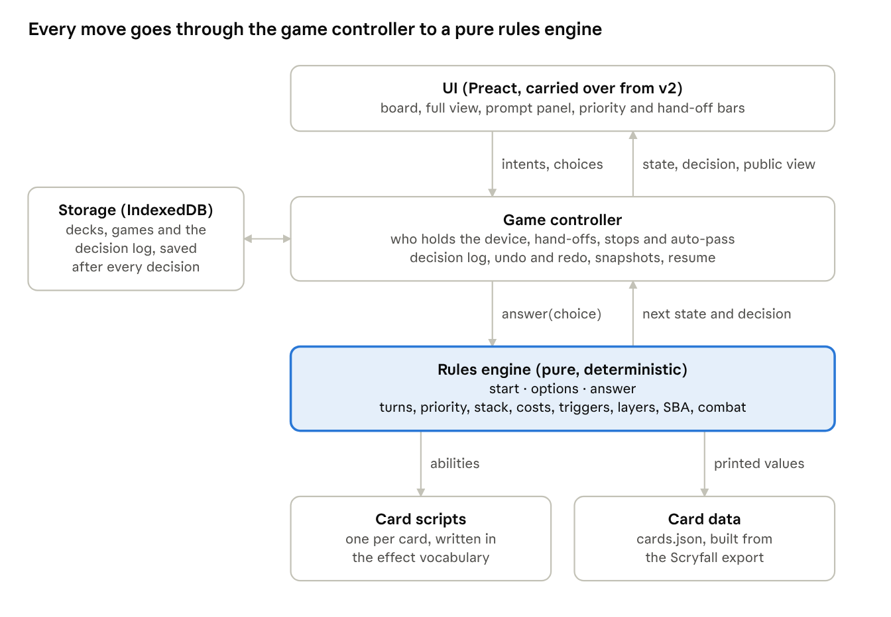
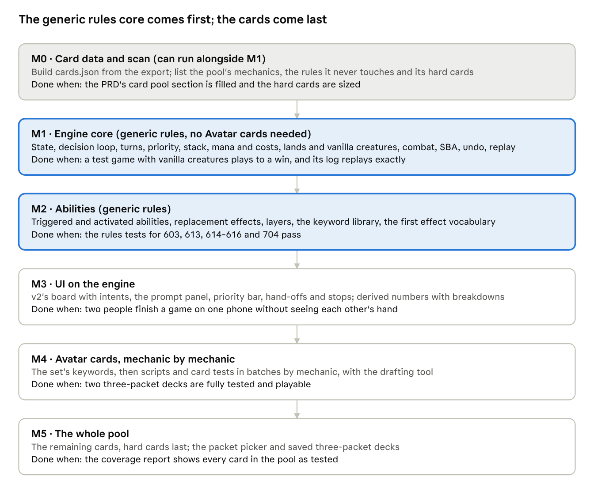

# Travel Tabletop v3 — Technical design

Nov 23, 2026 · @Lawrence Tsang

## Overview

v3 is v2's playmat UI on top of a new rules engine: a pure, deterministic state machine that runs the game until it needs a player's decision, then waits. The engine and the card scripts are most of the work; the UI is largely v2's, with drags turned into intents and a prompt panel added.

| Area                     | From v2                                                        | In v3                                                                                           |
|--------------------------|----------------------------------------------------------------|-------------------------------------------------------------------------------------------------|
| UI (`src/ui/`)           | Board, rows, piles, full view, gestures, sheets, tips, log     | Kept. Drags send intents instead of moves; adds the prompt panel, priority bar and hand-off bar |
| Engine (`src/engine/`)   | `apply(state, command)` that moves cards and checks invariants | Replaced by the rules engine. v2's invariant checker is the pattern for v3's                    |
| Host (`src/host/`)       | Command queue, undo snapshots, log, replay                     | Becomes the game controller: decision log, snapshots, seeded random source, replay              |
| Client and transport     | Sessions, WebRTC, pairing, TURN                                | Removed                                                                                         |
| Storage (`src/storage/`) | IndexedDB, Scryfall import, art, backups                       | Kept; import reads the bundled card file instead of the Scryfall API                            |
| Cards (`src/cards/`)     | None                                                           | New: card data and one script per card                                                          |

Stack unchanged: Preact, strict TypeScript, Vite, IndexedDB, Vitest with fast-check, Playwright. New repository; v2's code is copied in where it carries over, not shared as a package.

## Architecture



The UI never changes the game itself: it sends intents and choices to the game controller, which answers the engine's pending decision and hands back the new state with what the holder of the device may see. The engine reads the card scripts for abilities and the card data for printed values; storage saves the decision log after every step.

## Game state

One immutable `GameState` value holds the whole game; every engine step returns a new one. It holds only facts. Everything derivable (power, toughness, legal actions, costs) is computed from it on demand and cached by state version.

```ts
interface GameState {
  seq: number;                        // bumps on every change; the cache key for derived values
  decks: Record<PlayerId, PacketId[]>; // the three packets each player picked
  turn: number; active: PlayerId; step: Step; priority: PlayerId | null;
  passes: number;                     // consecutive passes with the stack unchanged
  players: Record<PlayerId, PlayerState>;  // life, poison, mana pool, lands played, lost
  objects: Record<ObjectId, GameObject>;   // every card, token, spell and ability that exists now
  zones: Record<ZoneId, ObjectId[]>;       // libraries, hands, graveyards, exile; one shared battlefield; the stack
  effects: ContinuousEffect[];        // from resolved spells and abilities, each with a timestamp and a duration
  delayed: DelayedTrigger[];          // "at the beginning of the next end step", ...
  pendingTriggers: PendingTrigger[];  // triggered but not yet on the stack
  history: TurnHistory;               // per-turn facts cards ask about: cards drawn, spells cast, damage dealt, lands played
  rng: RngState;                      // the seeded random source, so a replay draws the same
  decision: Decision | null;          // what the engine is waiting for, if anything
  result: GameResult | null;
}
```

**Objects and identity.** A `GameObject` points at its physical card (`cardId`, the same for the whole game) but has its own `ObjectId`. A zone change makes a new object with a new id (CR 400.7), so "exile it, then return it" gives a new object, and an effect that said "that creature" stops finding it. Tokens and copies are objects with no card, or a copied card.

**What an object stores:** owner, controller, tapped, flipped, face down, counters, damage marked, attached to, summoning-sick (entered this turn under this controller), its timestamp, and combat state (attacking, blocking which). Its printed characteristics come from the card data; every current characteristic comes from the layer system.

**Battlefield.** One shared zone, as the rules have it. The UI still splits it into each player's battlefield and lands rows, by controller and by type, as v2 shows it.

**Timestamps.** One counter for the game. Every object entering the battlefield and every continuous effect gets the next value, which orders effects within a layer.

## The decision loop

The engine is three pure functions. It never waits and never touches the screen. It runs forward until the rules need a player's choice, records that as `state.decision`, and returns.

```ts
start(setup: GameSetup, seed: number): GameState          // shuffles, deals, runs to the first decision (a mulligan)
options(state: GameState): Options                        // what the waiting player may answer, with reasons for what they may not
answer(state: GameState, choice: Choice): GameState | Refusal  // checks the choice, applies it, runs to the next decision
```

**Running forward** repeats until a decision is needed or the game ends:

1. Perform turn-based actions for the step (untap, draw, damage, cleanup).
2. Check state-based actions until none apply.
3. Put pending triggers on the stack, active player's first. Each trigger's order, targets and modes are decisions.
4. Give priority to the player the rules say. That is a decision.
5. When both players pass in a row: resolve the top of the stack, or, with an empty stack, move to the next step.

**Decisions are data.** One union type covers every choice the rules give a player:

- **Priority:** pass, cast, play a land, activate.
- **Casting a spell or activating an ability** goes through the steps of CR 601.2 in order, one decision each: modes, targets, X, how to split damage or counters, then paying.
- **Mana:** which sources pay which part of a cost.
- **Combat:** declare attackers, declare blockers, assign combat damage.
- **Ordering:** triggers, and replacement effects that compete.
- **Choosing cards:** discard, search, scry, "look at the top N".
- **Yes or no:** a "may" ability.
- **The mulligan.**

Each decision names the player it belongs to; the controller uses that for hand-offs.

**Casting can be backed out.** Until mana is paid, a cast in progress lives in the state as a partial activity. Cancel returns to the priority decision before it; that's a local undo, not logged as a move.

**Stops are not rules.** The engine always gives priority as the rules say. Stops and auto-passing live in the game controller, which answers "pass" for a player who has no stop there. Those passes are logged as automatic and skipped by Undo. So the engine stays a plain rules machine, and stops can change without touching it. The controller also passes a player's priority right after they cast, unless the cast set "hold priority", and honours a player's announced "pass this combat" or "pass until end of turn".

## Rules subsystems

Each subsystem is a module in `src/engine/` with its own tests against the Comprehensive Rules section it implements.

| Module        | Rules       | What it does                                                                                                                                                                                                                                                                                                                                                                                                                                                                                                                                                                                                                                                                                                                                                                                                                               |
|---------------|-------------|--------------------------------------------------------------------------------------------------------------------------------------------------------------------------------------------------------------------------------------------------------------------------------------------------------------------------------------------------------------------------------------------------------------------------------------------------------------------------------------------------------------------------------------------------------------------------------------------------------------------------------------------------------------------------------------------------------------------------------------------------------------------------------------------------------------------------------------------|
| `turn.ts`     | 500–514     | The step machine and turn-based actions; the first-strike damage step only when a creature in combat has first or double strike                                                                                                                                                                                                                                                                                                                                                                                                                                                                                                                                                                                                                                                                                                            |
| `priority.ts` | 117         | Who has priority, consecutive passes, when the stack resolves or the step ends                                                                                                                                                                                                                                                                                                                                                                                                                                                                                                                                                                                                                                                                                                                                                             |
| `stack.ts`    | 405, 608    | Resolving: targets are checked again; with every target illegal the spell or ability does nothing, with some illegal only the illegal part is skipped; a permanent spell enters the battlefield                                                                                                                                                                                                                                                                                                                                                                                                                                                                                                                                                                                                                                            |
| `cast.ts`     | 601, 602    | Casting and activating as the ordered steps of 601.2, each a decision; timing checks (sorcery speed, "activate only once each turn")                                                                                                                                                                                                                                                                                                                                                                                                                                                                                                                                                                                                                                                                                                       |
| `costs.ts`    | 118, 601.2f | Total cost = the printed or alternative cost, then additional costs, then increases, then reductions; non-mana costs (tap, sacrifice, discard, exile from a graveyard, pay life)                                                                                                                                                                                                                                                                                                                                                                                                                                                                                                                                                                                                                                                           |
| `mana.ts`     | 106, 605    | Mana pools, mana abilities, and the payment solver below                                                                                                                                                                                                                                                                                                                                                                                                                                                                                                                                                                                                                                                                                                                                                                                   |
| `events.ts`   | 603         | Every action the engine takes emits a typed event (zone change, tap, damage, cast, counter added, step began, attackers declared)                                                                                                                                                                                                                                                                                                                                                                                                                                                                                                                                                                                                                                                                                                          |
| `triggers.ts` | 603         | Matches events to triggered abilities, "intervening if" checked on triggering and again on resolving; leaves-the-battlefield triggers are checked against the state before the event (603.10)                                                                                                                                                                                                                                                                                                                                                                                                                                                                                                                                                                                                                                              |
| `replace.ts`  | 614–616     | Replacement and prevention effects, applied as an event is about to happen, each at most once per event; the affected player or controller orders competing ones (self-replacement first)                                                                                                                                                                                                                                                                                                                                                                                                                                                                                                                                                                                                                                                  |
| `layers.ts`   | 613         | Characteristics from layers 1 to 7 (copy, control, text, type, colour, abilities, power and toughness 7a–7d) in timestamp order; dependencies only if a card in the pool needs them                                                                                                                                                                                                                                                                                                                                                                                                                                                                                                                                                                                                                                                        |
| `sba.ts`      | 704         | The state-based actions listed in the PRD, repeated until none apply                                                                                                                                                                                                                                                                                                                                                                                                                                                                                                                                                                                                                                                                                                                                                                       |
| `combat.ts`   | 506–511     | Legal attack and block declarations as a check on the whole declaration (menace and "can't block alone" need that); damage with first strike, double strike, trample, deathtouch and lifelink; the attacking player divides damage among blockers freely, since the 2024 rules removed damage assignment order. Assigning damage is a decision only when the split can change the result: two or more blockers, and either trample or too little power to give every blocker lethal damage (toughness minus marked damage, or 1 from deathtouch). Its pre-filled answer gives lethal damage to blockers in ascending order of lethal needed, then the rest to the last blocker or, with trample, the player. The engine checks that the total equals the power and, with trample, that every blocker has lethal before the player gets any |

**The mana payment solver.** It answers two questions: can this cost be paid at all (for highlighting legal moves), and with which sources (for paying). Paying a cost is a flow problem, not bin packing. Sources (untapped lands and other mana abilities, plus mana already floating) sit on one side, each with a capacity: usually 1, more for a source that adds several. Coloured symbols sit on the other side, each joined to the sources that can make its colour; a hybrid symbol is joined to the sources of either colour. The cost is payable exactly when a maximum flow saturates every coloured symbol and the total capacity is at least the cost's mana value. Whatever capacity is left pays the generic part, since any mana pays generic. Hall's theorem says when that matching exists, and a maximum flow finds it in polynomial time: with at most about 15 sources and 10 symbols here, well under a millisecond. Players never tap for mana by hand; every payment goes through the solver. Among several payments it prefers, in order: lands over creatures; leaving untapped the colours the player's hand and abilities still need this turn; and keeping two-colour sources open over one-colour ones. This is a min-cost flow, with costs on the edges for these preferences. It turns the payment into a decision only when the best payment taps a creature (a mana creature, an earthbent land, a creature helping a waterbend cost), or when two payments tie on cost but leave different colours open. The pool adds three wrinkles. Hybrid symbols ({U/B} and nine other pairs) are edges to either colour. Waterbend costs let untapped artifacts and creatures stand in for generic mana, one each, as extra sources for the generic part only. Firebending's mana is tagged "lasts until end of combat", so the pool does not empty it between combat steps. The pool has no Phyrexian mana.

**Legal moves.** `legalActions(state, player)` lists every action the player could start now, each tested the way `answer` would test it:

- **Timing:** instant or sorcery speed, the land drop, "activate only once".
- **Costs:** the mana cost payable by the solver above, with X at its smallest (X = 0). Non-mana costs must be payable too: something untapped to tap, something to sacrifice or discard.
- **Targets:** at least one legal choice for every required target. A spell with no legal target can't be cast.
- **Restrictions:** "can't attack", defender, summoning sickness, and the like.

Each action is checked alone, so two cards may each be castable but not both together. That matches what a player needs to see: "I could cast this". The list is recomputed once per state (memoised on `seq`). A hand of about 10 cards against about 15 sources is a few hundred flow problems at most, each tiny. Actions that fail keep their reason, which feeds the greyed lines in the full view.

## Cards

Every card is printed data plus a hand-written script in a small effect vocabulary. The engine never reads rules text at play time: text is for people, scripts are for the engine.

**Card data.** A script, `scripts/build-cards.ts`, reads the v2 deck export (its manifest holds the packets, each card's full Scryfall record and the rulings, beside the images) and writes two things, both committed so that no build needs the export: `src/cards/cards.json` and `public/cards/`. The JSON holds the 76 packets, every printing in them and the 11 tokens, and the rulings by Oracle id. For each printing it keeps the Scryfall id (the key packets use), the Oracle id (the key card scripts use), name, mana cost and mana value, type line, Oracle text, power and toughness, colours and colour identity, keywords, layout, set, collector number and rarity. `public/cards/` holds each printing's large front image, named by its SHA-256 and checked against it (354 files, 44 MB). The script fails on anything the pool doesn't expect, such as a packet that isn't 20 cards or a double-faced card. The export is the one source of truth for the pool; a card not in it does not exist. What the export lacks (the mana a card produces, the tokens it makes) comes from the card scripts.

**Scripts.** One file per card, `src/cards/<set>/<name>.ts`, keyed by Oracle id. A script lists the card's abilities as data built from the vocabulary:

```ts
// Gran-Gran (the screenshot from v2): a trigger and a conditional cost reduction
export default card('Gran-Gran', {
  triggered: [{ when: becomesTapped(self), effect: [draw(you, 1), discard(you, 1)] }],
  statics: [{ while: count(cardsIn(graveyard(you)), isSubtype('Lesson')).atLeast(3),
              effect: reduceCost(spellsYouCast(not(isType('Creature'))), generic(1)) }],
});
```

**The vocabulary** is the set of building blocks scripts may use:

- **Triggers:** enters, leaves, dies, attacks, blocks, becomes tapped, casts, step begins, damage dealt.
- **Effects:** draw, discard, damage, gain or lose life, create token, counters, "gets +X/+Y until end of turn", destroy, exile, return to hand, tap or untap, search, scry, mill, sacrifice, add mana, gain control, copy.
- **Selectors and conditions:** "target creature an opponent controls", counts, comparisons.
- **Durations:** until end of turn, while, until it leaves.
- **Costs:** mana, tap, sacrifice, discard, pay life.

Keywords (flying, haste, trample, the set's bending keywords) are implemented once in a keyword library and referenced by name. A card that needs something new adds it to the vocabulary, with its own tests, never as a one-off in the script.

**Drafting from text.** A tool reads each card's Oracle text and drafts a script for common templates: keyword lines, "When ~ enters, draw a card", "~ gets +1/+1 until end of turn". A person reviews every draft, and nothing drafted is trusted unreviewed. The unusual cards are written by hand from the start.

**Coverage.** Each card has a status: *missing*, *scripted*, or *tested* (its script has a scenario test showing the printed behaviour). Deck validation lets only *tested* cards into a game. A coverage report, built with the app, lists the pool by status and by the vocabulary it still lacks.

## Derived numbers

Every number the PRD calls auto-tallied is a pure function of the state, computed with its breakdown in one pass, so what's shown and what's explained can't disagree.

```ts
interface Derived<T> { value: T; parts: Part[] }   // parts: { label, amount, source?: ObjectId, layer?: string }
characteristics(state, id): Characteristics        // layers 1–7 for one object, every field a Derived
costOf(state, cast): Derived<ManaCost>             // printed or alternative, then additional, increases, reductions, tax
legalActions(state, player): Action[]              // also feeds the greyed "why not" reasons in the full view
```

**Power and toughness** fold the layer 7 effects in order:

1. 7a: characteristic-defining abilities.
2. 7b: setting effects.
3. 7c: modifying effects and counters, so "until end of turn" changes and +1/+1 counters both land here.
4. 7d: switching.

Each step adds a part with its source. The badge shows `value`; a tap shows the `parts`.

**Caching.** Derived values are memoised per `state.seq` and object id. A step that changes nothing about an object still invalidates its entry, which keeps the cache trivially correct; the board has at most a few dozen objects, so recomputing them all is cheap.

**Life and damage** are not derived. They're facts in the state, changed by events. Their history (who dealt what) comes from the event log for the breakdown: "Life 14: 20, −3 Kiln Brute, −3 Spark Volley".

## Hidden information and hand-offs

The game controller tracks who is holding the device (`viewer`: a player, or `nobody` while blinded), apart from who the engine is waiting for (`decision.player`). When they differ, the UI shows the public view and the hand-off bar; nothing hidden renders until the right player taps Look.

**Visibility** stays one function, carried over from v2's `canSeeFace`: `visibleTo(state, objectId, viewer)`. It's true for public zones, for the owner's own hand and private looks, and for revealed cards. Every component that draws a card face goes through it.

**Pass without looking.** A priority decision can be answered "pass" from the hand-off bar, without unblinding. A decision that is not a priority pass (blocks, a discard, a target) needs Look.

**Stops can't leak, by construction.** The windows are one fixed table, the same for both players and shown at setup, so a window opening reveals nothing. The auto-pass policy is a function `stopsHere(view, player, stops)`. Its `view` is `publicView(state)`: the state with hidden zones reduced to counts. With no access to hands, a policy can't stop or skip based on them, and the type checker enforces that.

**Public wording.** Log lines and the hand-off bar describe events as both players may see them (v2's describe rules): a card's name only if both players could see it, otherwise "a card". The full log, with hidden names, is only for export after the game.

## Undo, randomness, persistence and replay

A game is fully described by its setup (formats, decks, names), its seed and its list of decisions. Replaying the decisions on `start(setup, seed)` rebuilds the exact state, and everything here follows from that.

**Randomness.** One seeded generator (a small PCG or xoshiro, a few lines, no dependency) lives in `state.rng`. Shuffles, coin flips and random choices draw from it. Since the state carries it, undo restores it too, and redo draws the same results.

**Decision log.** Each entry holds the decision answered, the choice, whether the controller auto-passed it, and the public text. It's stored in IndexedDB after every decision, as v2 stores commands. Automatic events are logged too (with their trigger source, targets and results), since a bug report needs them even though replay doesn't.

**Undo** pops back to the state before the last decision that wasn't an auto-pass. States come from snapshots: every state is kept in memory for the current turn. On disk, one snapshot is kept per turn, and anything older is rebuilt by replaying from the nearest snapshot. Redo keeps the popped decisions and answers them again; the next new decision clears them.

**Judge actions** are a separate input type, `judge(state, edit, reason)`. The edit is a move, a tap, counters or a life total; it's applied as is and then state-based actions run. It goes into the decision log like a decision, so replay still works. Each one also writes a bug report: the build id, setup, seed, every decision and automatic event so far, the full state before the edit (hidden zones included), the legal actions offered at that point, the edit's exact diff, and the reason. Replaying the report up to the judge entry reproduces the bug; with the fix in place, the report becomes a golden test asserting the corrected result.

**Resume** loads the newest snapshot and replays the decisions after it, then blinds.

**Engine version.** Replay is exact only with the same engine and scripts. Each game records the app's build id. A finished game from an earlier build keeps its log and final state but isn't replayed. A game in progress from an earlier build resumes from its last snapshot, with a warning that undo past that point is off.

## Testing

Rules bugs are the main risk, so most tests sit below the UI, and each layer has a test written for it.

| Kind           | What it checks                                                                                                                                                               | Tool                            |
|----------------|------------------------------------------------------------------------------------------------------------------------------------------------------------------------------|---------------------------------|
| Rules tests    | One Comprehensive Rules section at a time, on small built states: priority passes, 608.2b partial fizzles, 613 layer order, 704 actions, the 2024 damage division            | Vitest                          |
| Card tests     | Each card's printed behaviour in a scenario ("Gran-Gran taps: draw one, discard one"); a card is *tested* only when it has one                                               | Vitest, with a scenario builder |
| Invariants     | After every step: every object in exactly one zone, no token off the battlefield, no attacker without combat, characteristics computable, no decision while the game is over | `checkInvariants`, as in v2     |
| Property tests | Random legal decisions from random decks never break an invariant or throw; replaying a game's log gives the same state                                                      | fast-check                      |
| Golden games   | Recorded games whose logs must replay to the same final state after every change                                                                                             | Vitest fixtures                 |
| UI scenarios   | Hand-offs never show a hidden card to the wrong viewer; intents, prompts, undo, resume                                                                                       | Playwright, as in v2            |

**Scenario builder.** Tests state a position directly instead of playing up to it: "Lawrence has Gran-Gran untapped and three Lessons in the graveyard; Claire has 20 life". Then they feed decisions and check the result.

## Milestones



M1 and M2 (highlighted) are the generic core: they need no Avatar card, only the Comprehensive Rules. M0 can run alongside M1, but it should finish before M2's effect vocabulary is fixed, so the vocabulary is built for the cards that exist. No dates yet: M0's scan sizes M4 and M5.

## Adding cards later

A new card costs as much as its rules are new to the engine, so the engine is built to the Comprehensive Rules, not to the Avatar pool. Adding cards is then mostly scripting. Each future card falls into one of three tiers:

| Tier               | What the card needs                           | Work                                              | Example                                                           |
|--------------------|-----------------------------------------------|---------------------------------------------------|-------------------------------------------------------------------|
| 1\. Script only    | Effects the vocabulary already has            | Write the script and its card test                | Another "deal 3 damage to any target", another earthbend creature |
| 2\. New vocabulary | A new building block on rules the engine has  | Add the primitive with its tests, then the script | A new trigger condition, "return up to two cards"                 |
| 3\. New rules      | A mechanic or card type the engine leaves out | An engine module with rules tests                 | Planeswalkers, double-faced cards, control changes                |

**What keeps tier 3 small.** The core modules implement the general rule, not the Avatar subset:

- **Layers:** all seven layers and timestamps, with dependencies stubbed.
- **Frameworks:** replacement effects and triggers as general systems.
- **Objects:** a face list (one face today) and a controller separate from the owner. Double-faced cards and control changes then extend the engine without rewriting it.

The rules the pool never touches are left out of play, not out of the data model.

**Import pipeline.** A new export goes through the same build step. The coverage report then lists the new cards as *missing*, sorted by tier: unknown keywords and unmatched templates suggest tier 2 or 3. Deck validation keeps them out of games until they are *tested*. Nothing about a new card needs to be anticipated; the report shows what's new.

**The real cost** is tier 3, and it's known per set before any code is written, by the same scan done for the Avatar pool.

## Risks

The biggest risk is scope: a rules engine plus one script per card is far more work than v2, and a single wrong card can spoil a game.

| Risk                              | Why it matters                                                                                | Mitigation                                                                                                                            |
|-----------------------------------|-----------------------------------------------------------------------------------------------|---------------------------------------------------------------------------------------------------------------------------------------|
| Card scripting effort             | Hundreds of cards, each needing a script and a test                                           | Build order by mechanic, not by card; the drafting tool for common templates; play with any deck as soon as its cards are tested      |
| A card that breaks the vocabulary | Copy effects, control changes or rule-bending statics can need engine work, not just a script | Find them in the export first (the PRD's "hard cards"); size them before committing to the whole pool                                 |
| A rules bug mid-game              | Strict play has no free-form moves to fix it                                                                 | Undo; the decision log exported with the bug report becomes a golden test once fixed; a judge action corrects the game by hand and writes that report |
| Hand-off fatigue                  | Too many hand-offs make one-device play tedious                                               | Stops and one-tap Pass; measure hand-offs per turn in real games and tune the defaults                                                |
| Layer dependencies (613.8)        | Rare, but hard to get right                                                                   | Implemented only if a card in the pool needs them, found by the export scan                                                           |
| Offline size                      | Bundled images could make the install large                                                   | Measured: 44 MB for the 354 large images; if that proves too much on a phone, fall back to v2's cache-on-first-use                                                                    |
| Rules changes after launch        | The Comprehensive Rules change with new sets                                                  | v3's pool is fixed, so only changes that touch these cards matter; check each update's bulletin against the rules tests               |
